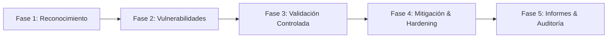

# Guía de Operación y Ciclo de Pentesting — Kali Linux en Synology

Esta guía consolida la metodología de uso, instalación de herramientas bajo demanda y coordinación de especialistas para auditorías de seguridad en la red `192.168.1.0/24`.

---

## 1. Vías de Acceso y Credenciales

| Interfaz | Acceso LAN Directo | Acceso Seguro Proxy Inverso (ACL LAN/VPN) | Credenciales |
| :--- | :--- | :--- | :--- |
| **Escritorio Web XFCE (KasmVNC)** | `https://192.168.1.150:6901` | `https://kali-desktop.admin.synology.me` | `kasm_user` / `KaliPass2026!` |
| **Terminal Web CLI (`ttyd`)** | `http://192.168.1.151:7681` | `https://kali-term.admin.synology.me` | `kali` / `KaliPass2026!` |
| **ChatOps Móvil (Telegram)** | Chat de Telegram autorizado | Bot `@admin` vía n8n (`rEShfn3jmYt83IVr`) | Whitelist `1307787776` |

---

## 2. Instalación de Herramientas Bajo Demanda

Para optimizar el uso de memoria RAM y almacenamiento en el Synology NAS, las herramientas se instalan únicamente cuando son requeridas mediante el gestor `manage_kali_docker.py` o directamente desde la consola web:

### Desde la estación de trabajo (vía tool local):
```bash
# Instalar paquete individual o suite
python tools/manage_kali_docker.py --action exec --root --cmd "apt-get install -y <herramienta>"

# Ejemplos recomendados para auditorías web y de red:
python tools/manage_kali_docker.py --action exec --root --cmd "apt-get install -y nikto gobuster sqlmap"
```

### Desde la Terminal Web (`ttyd` o Desktop):
```bash
sudo apt-get update
sudo apt-get install -y <herramienta>
```

---

## 3. Persistencia de Datos y Reportes

- **Ruta en Synology NAS:** `/volume1/docker/kali/data`
- **Ruta dentro de Kali Linux:** `/home/kasm_user/data`
- Todo script, lista de objetivos, diccionario de contraseñas (`wordlists`) o reporte generado debe guardarse dentro de `~/data/` para persistir ante reinicios o recreaciones del contenedor.

---

## 4. Ciclo Operativo por Fases de Pentesting (OWASP & WSTG)



1. **Fase 1: Reconocimiento y Escaneo (`skills/reconocimiento_escaneo.md`):**
   - Descubrimiento de hosts con `arp-scan --interface=eth1 --localnet`.
   - Barrido SYN sigiloso con Nmap: `nmap -sS -Pn -T3 -oN ~/data/scan_lan.txt 192.168.1.0/24`.
2. **Fase 2: Análisis de Vulnerabilidades (`skills/analisis_vulnerabilidades.md`):**
   - Detección de versiones y scripts NSE: `nmap -sV --script="banner,vuln" -oN ~/data/vulns.txt <IP_OBJETIVO>`.
   - Auditoría web de configuración y cabeceras OWASP.
3. **Fase 3: Validación y Pruebas (`skills/validacion_pruebas.md`):**
   - Validación ética asistida con confirmación explícita del usuario.
   - Verificación de no regresión y falsos positivos.
4. **Fase 4: Mitigación y Hardening (`skills/mitigacion_hardening.md`):**
   - Ajuste de reglas de cortafuegos en OpenWrt (`nftables/fw4`) o Synology DSM (`synofirewall`).
   - Aplicación de directivas defensivas y segmentación VLAN.
5. **Fase 5: Documentación y Reportes (`skills/redactor_auditor.md`):**
   - Consolidación de bitácoras y matrices de severidad bajo el estándar `no-ai-slop`.

---

## 5. Auditoría Web OWASP Automatizada desde Telegram (ChatOps)

La infraestructura cuenta con ejecución orquestada de pentesting web directamente desde Telegram vía **n8n (`Telegram ChatOps Master`)** o mediante el bot de servicio Python ([`telegram_kali_bot.py`](file:///c:/Users/Juan%20Carlos/Documents/Antigravity%20projects/Kali_Docker_Synology/tools/telegram_kali_bot.py)).

### A. Flujo de Ejecución en Telegram

1. **Acceso al Menú:**
   - En el menú principal de Telegram, ingresar a **`🛡️ Kali Linux Pentest`**.
   - Se presentarán las siguientes opciones operativas:
     - **`⚡ Pentest Agentes MCP`:** Flujo guiado de pentesting automatizado coordinado por agentes de IA.
     - **`🌐 Pentest Web OWASP`:** Flujo directo de auditoría web por perfiles OWASP.
     - **`🔌 Estado Servidores MCP`:** Verificación en tiempo real de la salud y herramientas activas en `MCP-Kali-Server` (puerto 5000) y `HexStrike-AI` (puerto 8888).
     - **`📊 Estado Contenedor`:** Diagnóstico de estado y puertos de Docker.
     - **`🔍 Barrido ARP LAN`:** Inventario de dispositivos activos en `192.168.1.0/24`.
2. **Ingreso del Objetivo:**
   - El bot solicitará el comando con la URL a evaluar:
     ```text
     /pentest https://ejemplo.com
     ```
     _O para pruebas locales:_ `/pentest http://localhost:3000/#/`
3. **Selección del Perfil Predefinido:**
   - El bot presenta un teclado táctil con los perfiles calibrados:
     - **⚡ Automatizado MCP (HexStrike + Kali):** Profiling inteligente de superficie de ataque con HexStrike AI, detección de tecnologías WAF/CMS, escaneo de puertos de servicio con Nmap en Kali Linux y matriz de hallazgos OWASP.
     - **🟢 Rápido / Pasivo:** Inspección no invasiva de cabeceras HTTP de seguridad (HSTS, CSP, X-Frame-Options), evaluación SSL/TLS y descarte de falsos positivos en SPAs.
     - **🟡 Estándar OWASP:** Perfil Rápido + Validación de métodos HTTP (OPTIONS, PUT, DELETE) y rutas de control (`robots.txt`, `.env`).
     - **🔴 Avanzado / Activo:** Perfil Estándar + Escaneo enfocado de vulnerabilidades y enumeración activa.
4. **Orquestación de Agentes y Entregables:**
   - El orquestador ejecuta [`tools/global/orquestador_pentest_web.py`](file:///c:/Users/Juan%20Carlos/Documents/Antigravity%20projects/tools/global/orquestador_pentest_web.py).
   - Invoca a [`tools/global/generar_reporte_pentest.py`](file:///c:/Users/Juan%20Carlos/Documents/Antigravity%20projects/tools/global/generar_reporte_pentest.py) para auditar y generar los reportes periciales.
   - Emite un mensaje ejecutivo en Telegram con la telemetría de los agentes MCP, la matriz de severidades, los hallazgos principales y la confirmación de guardado de los archivos en `output/`:
     - `informe_pentest_[objetivo]_[fecha].md`
     - `reporte_qa_[objetivo]_[fecha].txt`
     - `hallazgos_[objetivo]_[fecha].json`

